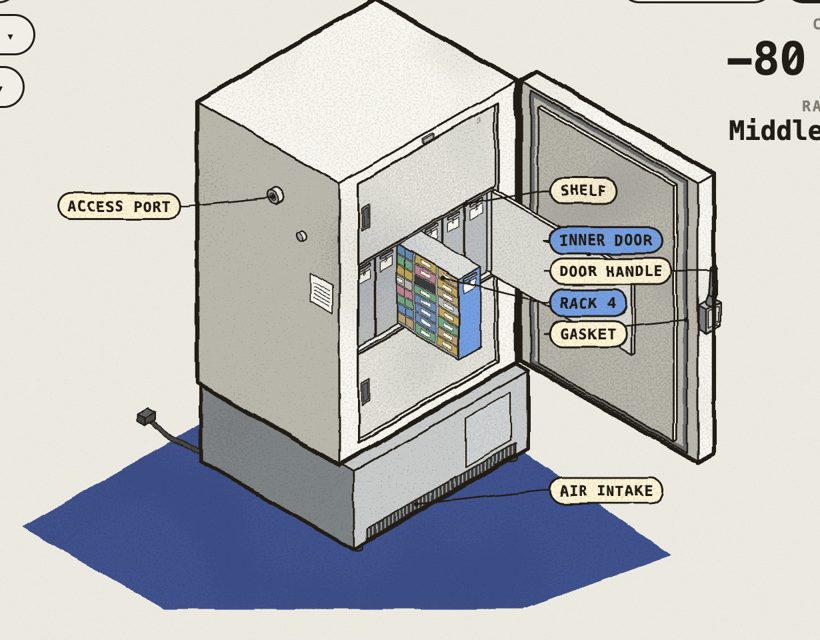
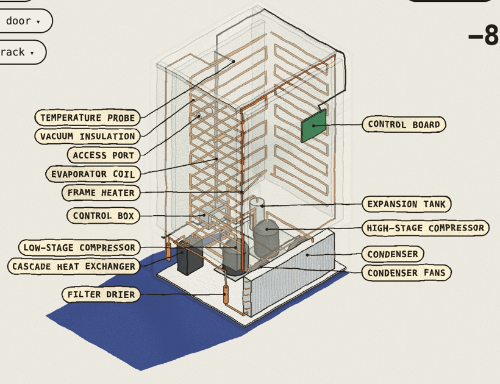
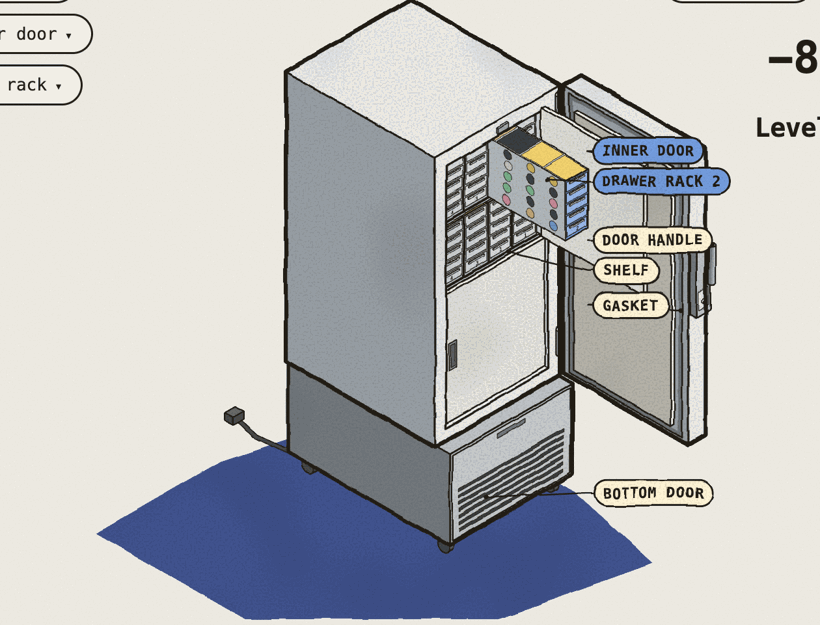
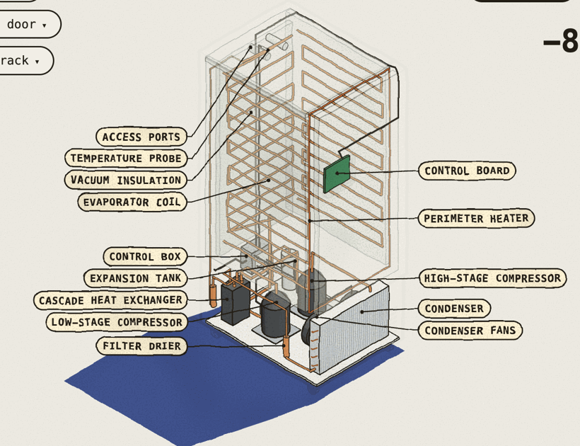

# 3D freezer layout: model demos

Two catalogued models, each as a full page and a clean page: the CryoCube F740 (below) and the
[TSX Universal TSX40086A](#tsx-universal-tsx40086a).

## CryoCube F740

This is a standalone, interactive figure of the **CryoCube F740 series ULT
freezer**. It is the first catalogued model for the 3D Layout page proposed in
[#215](https://github.com/Yuxin-Ren-SZ/FreezerManager/issues/215) and
[ADR 0003](../../adr/0003-freezer-3d-layout-api.md).

Open `cryocube-f740.html` in a browser. It is one self-contained file with no
network access.

**`cryocube-f740-clean.html`** is the same freezer with nothing else on the page. It has no wobble, see-through,
labels, readouts, notices or page controls. Only the three buttons below remain, plus clicking parts and dragging to turn.
The full page shows the same view with `?clean=1`.

| Door open, middle compartment, rack 4 out | See-through: cascade refrigeration |
|---|---|
|  |  |

| Control | What it does |
|---|---|
| **Open door / Close door** | Swings the outer door open on its right-hand hinges. Closing pushes any rack back in, shuts the inner door, then shuts the outer door. |
| **Inner door ▾** | Opens the Top, Middle or Bottom compartment's inner door, one at a time. It opens the outer door first if needed. |
| **Pull rack ▾** | Slides rack 1 to 6 of the open compartment toward you, showing its 8 x 4 boxes. It opens the doors first if needed. |
| Click a part | The handle toggles the door, an inner door toggles its compartment, and a rack pulls out or pushes back. |
| Drag, arrow keys | Turn the freezer all the way round. **Front view** resets the view. |
| **See-through** | Shows the cascade refrigeration system with labels: two compressors, condenser and fans, cascade heat exchanger, driers, expansion tank, evaporator coils, vacuum insulation, frame heater and wiring. |

The **Cabinet** readout is the cabinet temperature, sped up for the demo:
- With only the outer door open, the cabinet holds at -80 °C, because the inner doors keep the cold in.
- With an inner door open as well, it climbs, and the touchscreen alarms above -70 °C.
- After the door closes, the compressors pull it back down.

**Rack out** shows the location path the scene API returns (compartment, then rack).

URL parameters for screenshots: `?door=1`, `?inner=0|1|2`, `?rack=1..6`,
`?pull=0..1`, `?temp=-72`, `?xr=1&labels=1`, `?yaw=200&pitch=40`.

## Geometry (cm, from the Eppendorf data sheet)

| Item | Size |
|---|---|
| Outside (W x D x H) | 109.9 x 98 x 197.3 |
| Inside | 86.5 x 62.1 x 139 (740 L) |
| Compartments | 3, about 45.7 high, separated by 2 shelves |
| Racks | 6 per compartment, 13.5 x 56 x 43, 8 tiers x 4 boxes deep (576 two-inch boxes) |

These match the built-in `FreezerModel` catalogue entry in ADR 0003.

## TSX Universal TSX40086A

`tsx-40086.html` and `tsx-40086-clean.html` show a Thermo Scientific TSX Universal series ULT freezer, the 400-box
model featured in Thermo Fisher's [TSX 3D tour](https://www.thermofisher.com/us/en/home/virtual/tsx-ultra-low-freezer-3d-tour.html).
They use the same controls and the same full/clean split as the CryoCube.

| Door open, upper inner door, level 4 rack 2 out | See-through: cascade refrigeration |
|---|---|
|  |  |

| Control | What it does |
|---|---|
| **Open door / Close door** | Swings the main door open on its three right-hand hinges. Closing reverses rack, inner door and main door. |
| **Inner door ▾** | Opens the Upper or Lower inner door. Each covers two of the four levels. |
| **Pull rack ▾** | `L1 R1` to `L4 R4`: level 1 to 4 from the bottom, rack 1 to 4 from the left. The drawer rack slides out with its five drawers, and its boxes show through the perforated side plates. It opens the doors first if needed. |

| Item | Size (cm) |
|---|---|
| Outside (W x D x H) | 71.9 x 95.5 x 198.1 |
| Inside | 58.8 x 71.9 x 130.1 |
| Levels | 4 (3 shelves plus the floor), about 32 high, behind 2 inner doors |
| Racks | 4 per level, 13.6 x 66.5 x 29.5, 5 drawers x 5 boxes (400 two-inch boxes) |

Sources:
- Dimensions are from Thermo Fisher's TSX40086A listing.
- The layout comes from the tour's own text, saved from the page: 1 main door, 2 inner doors, a "4 shelf platform", sliding racks holding 25 boxes, two built-in access ports, a hinged bottom door, and R290/R600/R170 refrigerants.
- The look follows the render in the tour's fact sheet: light grey cabinet, a blue-framed 7-inch touchscreen at eye level on the handle side, the handle on the left edge and hinges on the right.

The tour's 3D model itself was not available offline, so smaller details are approximate. These include the handle shape, the hinge positions and where the access ports sit (placed on the back here).

URL parameters: `?door=1`, `?inner=0|1`, `?level=1..4&rack=1..4[&pull=0..1]`, `?temp=-72`, `?xr=1&labels=1`, `?clean=1`.

## Files

- `cryocube-f740.html` is the built, self-contained page to open.
- `cryocube-f740-clean.html` is the clean build (`window.CF_CLEAN = true` set before the figure script).
- `tsx-40086.html`, `tsx-40086-clean.html` and `tsx-40086.src.html` are the same three files for the TSX.
- `cryocube-f740.src.html` is the figure source for both CryoCube pages. It expects the Colorfigures engine `core.js` beside it.
  Rebuild with the Colorfigures skill's `scripts/build.py cryocube-f740.src.html cryocube-f740.html`.
  For the clean file, insert `` before `<title>` in that output.

The page is drawn with the Colorfigures isometric engine, credited in the page footer.
The production web view will reimplement the renderer under `src/web/` (slice 3 in the ADR).
This demo is a design reference, not shipped code.
